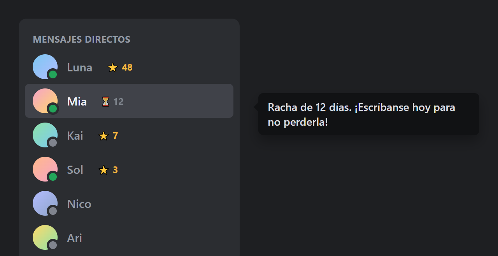

# Rachas

¿Cuántos días seguidos llevas hablando con tu mejor amiga? Rachas lo cuenta por ti.

En tu lista de mensajes directos, al lado del nombre de cada persona aparece una estrellita con el número de días seguidos en que **las dos** se escribieron. Si ayer hablaron pero hoy todavía no, la estrella cambia a un relojito ⏳ para que no se te olvide.

Sirve para **Vencord** y para **BetterDiscord** ([ver más abajo](#versión-para-betterdiscord)).



<sub>Demostración con nombres inventados.</sub>

## Cómo funciona
- Un día cuenta para la racha si tú escribiste al menos un mensaje y la otra persona también, ese mismo día (según tu hora local).
- La racha se muestra desde los 2 días seguidos.
- ⭐ **N**: ya se escribieron hoy, la racha está a salvo.
- ⏳ **N**: hablaron ayer, pero hoy falta que alguien escriba. Si se acaba el día sin mensajes de las dos, la racha vuelve a cero.
- Pasando el ratón por la estrella ves el detalle.
- Funciona en chats privados con una sola persona, no en grupos ni servidores.

## De dónde saca los días
Discord no guarda un contador de rachas, así que el plugin lo arma solo:
- Anota cada mensaje nuevo que llega a tus chats privados mientras Discord está abierto.
- Cuando abres un chat, revisa los mensajes que Discord carga y aprende de ahí los días que ya tenían. Si quieres que cuente una racha antigua, abre el chat y sube un poco para que se carguen más mensajes.
- Los días se guardan en tu computadora (solo la fecha, nunca el contenido de los mensajes), así que la racha sigue al cerrar Discord.

## Requisitos
- Windows, macOS o Linux con la aplicación de escritorio de Discord instalada.
- [Node.js LTS](https://nodejs.org) (versión 20 o superior).
- [Git](https://git-scm.com).
- pnpm (se instala con un comando, ver más abajo).
- Conexión a internet para descargar las dependencias (unos 200 MB).

## Instalación paso a paso
Los plugins propios no están en el instalador oficial de Vencord. Los plugins van compilados dentro de Vencord, así que hay que descargar su código fuente, añadir este plugin y volver a compilar. Los ajustes y los plugins que ya tengas no se pierden.

Si ya instalaste otro plugin propio (por ejemplo [LastSeen](https://github.com/ccrccne/vencord-lastseen)), ya tienes Vencord descargado: salta al paso 4.

Los comandos son para Windows (PowerShell). En macOS y Linux son los mismos, salvo la instalación de Node y Git.

### 1. Instalar Node.js y Git
En Windows, con winget:
```bash
winget install OpenJS.NodeJS.LTS Git.Git
```
Cierra la terminal y ábrela de nuevo para que reconozca los programas. Comprueba que funcionan:
```bash
node -v
git --version
```

### 2. Instalar pnpm
```bash
npm i -g pnpm
```

### 3. Descargar Vencord
```bash
git clone https://github.com/Vendicated/Vencord.git
cd Vencord
```

### 4. Descargar este plugin y copiarlo
Descarga este repositorio (botón verde **Code → Download ZIP**, o con `git clone https://github.com/ccrccne/vencord-rachas.git`).

Copia la carpeta `rachas` dentro de `Vencord/src/userplugins/`. Si la carpeta `userplugins` no existe, créala. Debe quedar así:
```
Vencord/
└── src/
    └── userplugins/
        └── rachas/
            └── index.tsx
```

### 5. Instalar dependencias y compilar
Dentro de la carpeta `Vencord`:
```bash
pnpm install
pnpm build
```
`pnpm install` tarda unos minutos la primera vez. Si aparecen avisos amarillos (`WARN`) sobre la versión de pnpm o la velocidad de descarga, no son errores.

### 6. Inyectar en Discord
Cierra Discord por completo, incluido el icono de la bandeja del sistema, y ejecuta:
```bash
pnpm inject
```
Es interactivo: te muestra tus instalaciones de Discord y eliges la que quieras con las flechas y Enter. Cuando termine, abre Discord.

## Activar el plugin
1. En Discord, abre **Ajustes de usuario**.
2. En la sección **Vencord Settings**, entra en **Plugins**.
3. Escribe `Rachas` en el buscador.
4. Activa el interruptor.

Abre tus mensajes directos y entra a algún chat: las estrellitas aparecen al lado de los nombres.

## Versión para BetterDiscord
En BetterDiscord la racha se ve con **clic derecho** sobre la persona: al final del menú sale `⭐ Racha: N días`.

1. Instala [BetterDiscord](https://betterdiscord.app) si no lo tienes.
2. Descarga [`betterdiscord/Rachas.plugin.js`](betterdiscord/Rachas.plugin.js) (ábrelo y pulsa **Download raw file**).
3. En Discord, ve a **Ajustes de usuario → BetterDiscord → Plugins** y pulsa **Open Plugins Folder**.
4. Copia el archivo en esa carpeta y activa **Rachas** en la lista.

No uses Vencord y BetterDiscord a la vez: instala solo uno de los dos.

## Estructura del repositorio
```
vencord-rachas/
├── rachas/
│   └── index.tsx            # plugin para Vencord
├── betterdiscord/
│   └── Rachas.plugin.js     # plugin para BetterDiscord
├── images/                  # imagen de demostración
└── README.md
```

## Aviso
Los mods de cliente como Vencord y BetterDiscord van contra los Términos de Servicio de Discord. En la práctica rara vez se sanciona su uso, pero el riesgo existe. Este plugin solo lee datos que Discord ya envía a tu cliente y no automatiza ninguna acción. Úsalo bajo tu propia responsabilidad.

Autor: **cancercocaine** (Discord) · [ccrccne](https://github.com/ccrccne) (GitHub)
